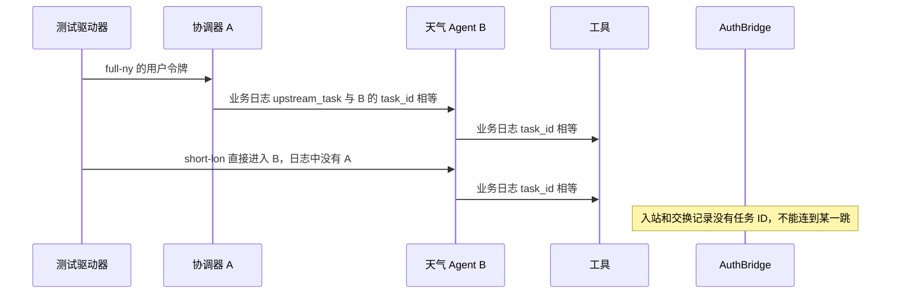

# 授权链与可审计性基线

输出目录 `2026-11-16T03-43-03Z`。

审计程序只读了 `audit-input` 里的系统日志、服务响应和固定规则。评分程序才读取实验真值。无法判断不计为通过。

## 指标

分母都是这次矩阵里实际产生的对象，不是估计的总体。

| 指标 | 分子 | 分母 |
| --- | --- | --- |
| 授权链完整重建 | 0 | 6 |
| 业务标识对齐 | 6 | 6 |
| 逐跳授权可追溯 | 0 | 28 |
| 交换记录唯一关联任务 | 0 | 11 |
| 跨任务错误关联 | 0 | 业务调用 |

授权链完整重建要求同时确定经过的实体、用户、每一跳的授权依据和委托历史。业务标识对齐只表示既有 LAB_CORR 文本能够对上，LAB_CORR 不是认证证明。

## 逐案例

| 运行 | 场景 | 执行 | 审计总体 | 业务标识 | 回答与工具 JSON | 工具 JSON 来源 |
| --- | --- | --- | --- | --- | --- | --- |
| conc1-lon | concurrent | 业务调用完成 | 只能部分重建 | 能够明确重建 | 无法判断 | 工具 JSON 出现在其他日志行，那些行没有这个任务 ID |
| conc1-ny | concurrent | 业务调用完成 | 只能部分重建 | 能够明确重建 | 无法判断 | 顺序邻接区间里有多份工具 JSON，且这些行没有任务 ID，无法判断 |
| conc2-lon | concurrent | 业务调用完成 | 只能部分重建 | 能够明确重建 | 无法判断 | 顺序邻接区间里有多份工具 JSON，且这些行没有任务 ID，无法判断 |
| conc2-ny | concurrent | 业务调用完成 | 只能部分重建 | 能够明确重建 | 无法判断 | 工具 JSON 出现在其他日志行，那些行没有这个任务 ID |
| cross-ny | cross_workload | 跨工作负载 | 不适用 | 不适用 | 不适用 | 未观察到 |
| deny-tool-t0 | deny_tool_direct | 授权结果 | 不适用 | 不适用 | 不适用 | 未观察到 |
| deny-exchange | deny_exchange | 授权结果 | 不适用 | 不适用 | 不适用 | 未观察到 |
| deny-audience | deny_wrong_audience | 授权结果 | 不适用 | 不适用 | 不适用 | 未观察到 |
| full-ny | full_path | 工具上游失败 | 只能部分重建 | 能够明确重建 | 工具上游失败 | 工具结果是暂时不可用，没有天气 JSON |
| short-lon | short_path | 工具上游失败 | 只能部分重建 | 能够明确重建 | 工具上游失败 | 工具结果是暂时不可用，没有天气 JSON |

工具上游失败的运行：full-ny、short-lon。回答与唯一工具 JSON 一致的运行：无。工具 JSON 无法按任务归属的运行：conc1-lon、conc1-ny、conc2-lon、conc2-ny。归属失败是因为 JSON 所在日志行没有任务 ID，并发时又落在交错区间里。

## 证据篡改

- delete_hop：发现异常。工具日志中未出现同一任务 ID
- modify_parent：发现异常。协调记录指向的任务在 Agent 日志中未出现；工具日志中未出现同一任务 ID。下游 Agent 和工具记录仍形成一条没有 A 的链，审计不能发现它本应属于被改掉的父调用。
- mix_record：发现异常。存在多个可能关联
- modify_correlation：发现异常。工具日志中未出现同一任务 ID

导出文件的 SHA-256 能看出副本被改过。这是外部完整性检查，没有计入上面的发现数。原系统没有把这个摘要写进认证日志。

## 未关联的认证事件

窗口内认证相关日志 179 条，其中令牌交换 11 条。全部因为没有共享任务标识而标为无法判断。拒绝原因出现在这些日志里，包括 audience 不匹配和缺少 Authorization，但不能指认到某一次驱动器请求。

## 时序

实线只表示驱动器发起的调用，以及业务日志里能够用同一个任务 ID 串起来的跳。AuthBridge 记录画在图外，因为它们不能连到某一跳。

## 跨工作负载调用

驱动器记录的后端调用 HTTP 200，MCP 结果 get_weather。
缺令牌 HTTP 401，原始 T0 HTTP 401。
来自 weather-service-advanced 的调用 HTTP 200，MCP 结果 get_weather，令牌指纹与后端调用相同：True。

原生认证日志只能看到令牌里的 clientID。它不能表示实际发送工作负载。允许这次调用，只说明 JWT 校验通过，不说明发送方就是 B。

## 能力来源

- 原系统：AuthBridge 记录主体、clientID、audience、拒绝原因；Keycloak 对交换请求返回允许或拒绝。这些记录没有任务 ID。
- 本轮之前已经加在常驻进程里的补丁：协调器、B 和工具日志中的 LAB_CORR。它能对齐业务标识，不能证明身份或委托。
- 本轮新增：测试驱动器保存的令牌指纹、来源 ServiceAccount、脱敏证据分目录、只读证据的审计程序和评分程序。没有修改运行中的认证策略，也没有新增运行时日志补丁。

