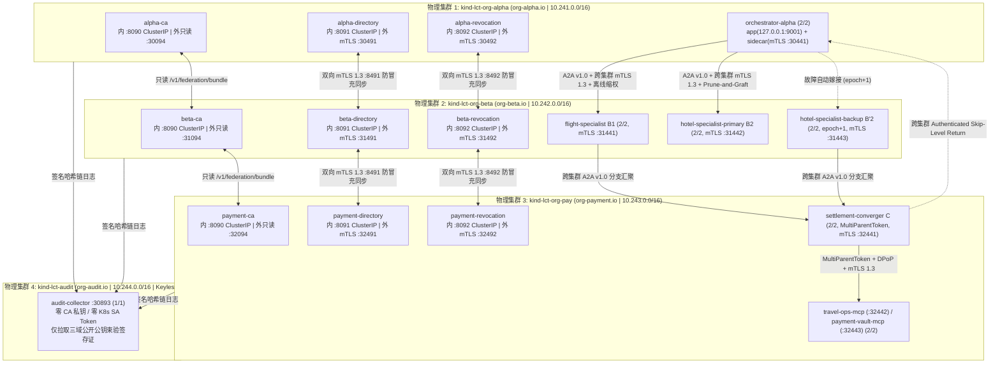

# Lineage Capability Tree (LCT) — Full-Lifecycle Governance Architecture (Milestone 1–4)

本目录（[lineage](file:///Users/hulalala/Desktop/A/lineage)）实现了面向**跨独立 Kubernetes 集群（Multi-Cluster Physical Federation）、多主体自治信任域、官方 A2A v1.0 标准协议栈与 MCP 工具平面**的「谱系能力树（Lineage Capability Tree, LCT）」全生命周期安全治理系统。系统在 **4 个物理完全独立的 Kind Kubernetes 集群**（4 套独立 `kube-apiserver`、4 套 `etcd`、4 套互不信任的 K8s OIDC 签名密钥与不重叠 L3 Pod/Service 子网）上完成了端到端验证，支持**双端口控制面边界硬化、全链路双向 SPIFFE X.509-SVID mTLS 1.3 + `NameConstraints(critical=True)` 加密与通道绑定、官方 A2A v1.0 JSON-RPC 2.0 + 实时 SSE 流式协议，以及整集群网络分区下的自治存活与 `503` Fail-Closed 恢复**。

---

## 1. 四集群物理联邦自治架构与全链路双向 X.509 mTLS 1.3 拓扑



---

## 2. 九大核心模块工程映射

| 模块路径 | 对应研究与协议职责 | 关键类与安全机制 |
| --- | --- | --- |
| [lineage/common/](file:///Users/hulalala/Desktop/A/lineage/common) | 密码学原语、双向 X.509 mTLS 1.3（含 `NameConstraints`）与 HTTP/SSE 基座 | `KeyPair`（`ES256`/`RS256`）、`X509DomainAuthority` & `X509FederationTrustStore`（强制 `NameConstraints(critical=True)` 锁定 `spiffe://<domain>` 与组织专属 DNS 子树，握手层 `CheckedSSLSocket` 强校验对端 EKU 与目标域名所属根 CA）、`WorkloadMTLSBundle`（仅经内存 tmpfs 装载后立即销毁）、`SSEResponse` |
| [lineage/a2a/](file:///Users/hulalala/Desktop/A/lineage/a2a) | **官方 A2A v1.0 标准协议栈** | 标准数据模型（`Part`、`Message`、`Artifact`、`Task` 7 态状态机）、`A2AServerEngine` & `A2AClient`（强制 `A2A-Version: 1.0`，支持 `SendMessage`、`SendStreamingMessage` 实时 SSE、`GetTask` 租户隔离、`CancelTask` 原子取消并自动触发跨集群谱系级联撤销） |
| [lineage/federation/](file:///Users/hulalala/Desktop/A/lineage/federation) | **物理分域自治 CA、双端口边界硬化与跨集群公钥束同步** | `AutonomousDomainCAService`（内网 `:8090` 仅验证本集群 `kube-apiserver` OIDC SA JWT 并签发含 `<sa>.<trust_domain>` 公开 FQDN SAN 的叶子证书；外部联邦端口 `:8094` 强制只读，`POST` 一律 `403 federation_endpoint_read_only`）、`FederationBundleSyncer` |
| [lineage/identity/](file:///Users/hulalala/Desktop/A/lineage/identity) & [lineage/registry/](file:///Users/hulalala/Desktop/A/lineage/registry) | 跨集群身份、公共 FQDN `AgentCard` 与双向 mTLS 联邦目录 | `AgentCard`（暴露 `/.well-known/agent-card.json` 与 `/.well-known/agent.json`，使用公开组织域名 `https://<sa>.<org-domain>:<port>`）、`AgentDirectoryService`（内网 `:8091` 本集群注册；外网 `:8491` 强制双向 mTLS 1.3 且封禁外部注册/隔离写接口 `403`） |
| [lineage/protocol/](file:///Users/hulalala/Desktop/A/lineage/protocol) | **研究点 1**：结构化权限格、离线衰减链、多父 DAG 信封与 RFC 9449 DPoP | `PermissionLattice`（工具/方法/数值上限/白名单/全链逐块原子配额偏序格 $P_{i+1} \subseteq P_i$ 与交运算 $\sqcap$）、`CompositePermission`、`LineageToken` / `MultiParentToken`、`DPoPVerifier` + `JTIReplayCache` |
| [lineage/revocation/](file:///Users/hulalala/Desktop/A/lineage/revocation) | **研究点 4**：跨集群双向 mTLS 级联撤销、整集群分区 Fail-Closed 与 Fagin 降级 | `LineagePrefixTrie`、`RevocationService`（内网 `:8092` 权威吊销；外网 `:8492` 强制双向 mTLS 1.3 同步并封禁外部 `/v1/revoke/workload`；当对等集群断网失联时对涉及该域的 `require_trust_domain` 查询严格返回 `503 federation_anchor_unavailable`） |
| [lineage/verifier/](file:///Users/hulalala/Desktop/A/lineage/verifier) & [lineage/audit/](file:///Users/hulalala/Desktop/A/lineage/audit) | **研究点 2**：末游叶子自适应风险锚定验证与独立第 4 集群零私钥因果审计 | `LeafVerifier`（全链最高历史风险单调锁存，对 `HIGH_RISK` 强制按全链涉及的信任域集合实时对账撤销锚点，失联即 `503 REVOCATION_ANCHOR_UNAVAILABLE` Fail-Closed）、独立集群 `AuditCollectorService` + `CausalChainAuditor` |
| [lineage/resilience/](file:///Users/hulalala/Desktop/A/lineage/resilience) & [lineage/sidecar/](file:///Users/hulalala/Desktop/A/lineage/sidecar) | **研究点 3**：跨集群双路径密码学自治恢复与通道绑定 Sidecar | `ResilientDelegationCoordinator`（跨集群向下 `Atomic Prune-and-Graft` + 向上 `Authenticated Skip-Level Return` 跨集群 mTLS `/healthz` 探活与 `expected_spiffe_id` 身份钉扎）、`LineageSidecar`（Channel + Token 双重绑定与回环隔离） |
| [lineage/k8s/multicluster/](file:///Users/hulalala/Desktop/A/lineage/k8s/multicluster) | **Milestone 4 四集群物理拓扑清单与离线编排脚本** | `kind-org-alpha.yaml` / `kind-org-beta.yaml` / `kind-org-pay.yaml` / `kind-audit.yaml`（4 套不重叠 Pod/Service 子网与 NodePort 映射）、`cluster-*.yaml` 零集群级 RBAC 清单、[run-e2e-multicluster-ollama.sh](file:///Users/hulalala/Desktop/A/lineage/k8s/run-e2e-multicluster-ollama.sh) |

---

## 3. 核心安全不变量

1. **四集群物理控制面与 OIDC 根信任隔离**：4 个 Kind 集群拥有各自独立的 `kube-apiserver` 与 OIDC 签名密钥，任一集群的 K8s ServiceAccount JWT 跨集群重放至其他域 CA 在签名 `kid` 校验阶段即 `403` 拒绝；独立第 4 集群 `kind-lct-audit` 零 CA 私钥、零 K8s SA 令牌挂载。
2. **双端口控制面边界硬化（Internal ClusterIP vs External mTLS/ReadOnly NodePort）**：签发、注册、吊销写入口仅在各集群内部 `ClusterIP`（`:8090/:8091/:8092`）可达；跨集群联邦端口仅暴露只读公钥束 `:8094` 与双向 mTLS 1.3 联邦同步端口 `:8491/:8492`。
3. **X.509 `NameConstraints(critical=True)` + 通道与令牌双重绑定**：任何被攻陷的外部域 CA 即使伪造异域 `spiffe://` URI 或异域 `*.org-*.io` DNS 叶子证书，也会在 OpenSSL C 握手层触发 `permitted subtree violation` 直接阻断。
4. **整集群分区下的自治存活性与高危操作 Fail-Closed**：单组织集群整体断网时，其余集群内部及跨存活集群业务保持 `200 OK` 自治运行，而因果链横跨失联集群的高危分账动作严格触发 `503 REVOCATION_ANCHOR_UNAVAILABLE` Fail-Closed，网络恢复后零重启自愈。

---

## 4. 本地一键复现命令（零网络下载依赖）

### 4.1 运行全量 54 项本地自动化测试套件（Milestone 1–4 功能与全部红队回归全覆盖）与微基准测试

```bash
cd /Users/hulalala/Desktop/A
/Users/hulalala/Desktop/A/src/cortex/authbridge/venv/bin/python3 -m lineage.tests.run_all
```

### 4.2 单独运行 Milestone 4 四集群物理联邦与双端口边界硬化测试套件

```bash
cd /Users/hulalala/Desktop/A
/Users/hulalala/Desktop/A/src/cortex/authbridge/venv/bin/python3 -m unittest lineage.tests.test_m4_multicluster_federation -v
```

### 4.3 一键拉起 4 个独立 Kind 集群 + 宿主机 Ollama `qwen2.5:3b` 跑通全部 6 组跨集群实测场景

```bash
bash /Users/hulalala/Desktop/A/lineage/k8s/run-e2e-multicluster-ollama.sh
```
