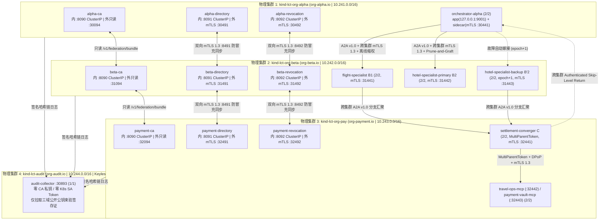

# Lineage Capability Tree (LCT) — Full-Lifecycle Governance Architecture (Milestone 1–4)

本目录（[lineage](file:///Users/hulalala/Desktop/A/lineage)）实现了面向**跨独立 Kubernetes 集群（Multi-Cluster Physical Federation）、多主体自治信任域、官方 A2A v1.0 标准协议栈与 MCP 工具平面**的「谱系能力树（Lineage Capability Tree, LCT）」全生命周期安全治理系统。系统在 **4 个物理完全独立的 Kind Kubernetes 集群**（4 套独立 `kube-apiserver`、4 套 `etcd`、4 套互不信任的 K8s OIDC 签名密钥与不重叠 L3 Pod/Service 子网）上完成了端到端验证，支持**双端口控制面边界硬化、全链路双向 SPIFFE X.509-SVID mTLS 1.3 + `NameConstraints(critical=True)` 加密与通道绑定、官方 A2A v1.0 JSON-RPC 2.0 + 实时 SSE 流式协议，以及整集群网络分区下的自治存活与 `503` Fail-Closed 恢复**。

---

## 1. 四集群物理联邦自治架构与全链路双向 X.509 mTLS 1.3 拓扑



---

## 2. 九大核心模块工程映射

| 模块路径 | 对应研究与协议职责 | 关键类与安全机制 |
| --- | --- | --- |
| [lineage/common/](file:///Users/hulalala/Desktop/A/lineage/common) | 密码学原语、双向 X.509 mTLS 1.3（含 `NameConstraints`）与 HTTP/SSE 基座 | `KeyPair`（`ES256`/`RS256`）、`X509DomainAuthority` & `X509FederationTrustStore`（强制 `NameConstraints(critical=True)` 锁定 `spiffe://<domain>` 与组织专属 DNS 子树，握手层 `CheckedSSLSocket` 强校验对端 EKU 与目标域名所属根 CA）、`WorkloadMTLSBundle`（仅经内存 tmpfs 装载后立即销毁）、`SSEResponse` |
| [lineage/a2a/](file:///Users/hulalala/Desktop/A/lineage/a2a) | **官方 A2A v1.0 标准协议栈** | 标准数据模型（`Part`、`Message`、`Artifact`、`Task` 7 态状态机）、`A2AServerEngine` & `A2AClient`（强制 `A2A-Version: 1.0`，支持 `SendMessage`、`SendStreamingMessage` 实时 SSE、`GetTask` 租户隔离、`CancelTask` 原子取消并自动触发跨集群谱系级联撤销） |
| [lineage/federation/](file:///Users/hulalala/Desktop/A/lineage/federation) | **物理分域自治 CA、双端口边界硬化与跨集群公钥束同步** | `AutonomousDomainCAService`（内网 `:8090` 仅验证本集群 `kube-apiserver` OIDC SA JWT 并签发含 `<sa>.<trust_domain>` 公开 FQDN SAN 的叶子证书；外部联邦端口 `:8094` 强制只读，`POST` 一律 `403 federation_endpoint_read_only`）、`FederationBundleSyncer` |
| [lineage/identity/](file:///Users/hulalala/Desktop/A/lineage/identity) & [lineage/registry/](file:///Users/hulalala/Desktop/A/lineage/registry) | 跨集群身份、公共 FQDN `AgentCard` 与双向 mTLS 联邦目录 | `AgentCard`（暴露 `/.well-known/agent-card.json` 与 `/.well-known/agent.json`，使用公开组织域名 `https://<sa>.<org-domain>:<port>`）、`AgentDirectoryService`（内网 `:8091` 本集群注册；外网 `:8491` 强制双向 mTLS 1.3 且封禁外部注册/隔离写接口 `403`） |
| [lineage/protocol/](file:///Users/hulalala/Desktop/A/lineage/protocol) | **研究点 1**：结构化权限格、离线衰减链、多父 DAG 信封与 RFC 9449 DPoP | `PermissionLattice`（工具/方法/数值上限/白名单/全链逐块原子配额偏序格 $P_{i+1} \subseteq P_i$ 与交运算 $\sqcap$）、`CompositePermission`、`LineageToken` / `MultiParentToken`、`DPoPVerifier` + `JTIReplayCache` |
| [lineage/revocation/](file:///Users/hulalala/Desktop/A/lineage/revocation) | **研究点 4**：跨集群双向 mTLS 级联撤销、整集群分区 Fail-Closed 与 Fagin 降级 | `LineagePrefixTrie`、`RevocationService`（内网 `:8092` 权威吊销；外网 `:8492` 强制双向 mTLS 1.3 同步并封禁外部 `/v1/revoke/workload`；当对等集群断网失联时对涉及该域的 `require_trust_domain` 查询严格返回 `503 federation_anchor_unavailable`） |
| [lineage/verifier/](file:///Users/hulalala/Desktop/A/lineage/verifier) & [lineage/audit/](file:///Users/hulalala/Desktop/A/lineage/audit) | **研究点 2**：末游叶子自适应风险锚定验证与独立第 4 集群零私钥因果审计 | `LeafVerifier`（全链最高历史风险单调锁存，对 `HIGH_RISK` 强制按全链涉及的信任域集合实时对账撤销锚点，失联即 `503 REVOCATION_ANCHOR_UNAVAILABLE` Fail-Closed）、独立集群 `AuditCollectorService` + `CausalChainAuditor` |
| [lineage/resilience/](file:///Users/hulalala/Desktop/A/lineage/resilience) & [lineage/sidecar/](file:///Users/hulalala/Desktop/A/lineage/sidecar) | **研究点 3**：跨集群双路径密码学自治恢复与通道绑定 Sidecar | `ResilientDelegationCoordinator`（跨集群向下 `Atomic Prune-and-Graft` + 向上 `Authenticated Skip-Level Return` 跨集群 mTLS `/healthz` 探活与 `expected_spiffe_id` 身份钉扎）、`LineageSidecar`（Channel + Token 双重绑定与回环隔离） |
| [lineage/k8s/multicluster/](file:///Users/hulalala/Desktop/A/lineage/k8s/multicluster) | **Milestone 4 四集群物理拓扑清单与离线编排脚本** | `kind-org-alpha.yaml` / `kind-org-beta.yaml` / `kind-org-pay.yaml` / `kind-audit.yaml`（4 套不重叠 Pod/Service 子网与 NodePort 映射）、`cluster-*.yaml` 零集群级 RBAC 清单、[run-e2e-multicluster-ollama.sh](file:///Users/hulalala/Desktop/A/lineage/k8s/run-e2e-multicluster-ollama.sh) |

---

## 3. 核心安全不变量

1. **四集群物理控制面与 OIDC 根信任隔离**：4 个 Kind 集群拥有各自独立的 `kube-apiserver` 与 OIDC 签名密钥，任一集群的 K8s ServiceAccount JWT 跨集群重放至其他域 CA 在签名 `kid` 校验阶段即 `403` 拒绝；独立第 4 集群 `kind-lct-audit` 零 CA 私钥、零 K8s SA 令牌挂载。
2. **双端口控制面边界硬化（Internal ClusterIP vs External mTLS/ReadOnly NodePort）**：签发、注册、吊销写入口仅在各集群内部 `ClusterIP`（`:8090/:8091/:8092`）可达；跨集群联邦端口仅暴露只读公钥束 `:8094` 与双向 mTLS 1.3 联邦同步端口 `:8491/:8492`。
3. **X.509 `NameConstraints(critical=True)` + 通道与令牌双重绑定**：任何被攻陷的外部域 CA 即使伪造异域 `spiffe://` URI 或异域 `*.org-*.io` DNS 叶子证书，也会在 OpenSSL C 握手层触发 `permitted subtree violation` 直接阻断。
4. **整集群分区下的自治存活性与高危操作 Fail-Closed**：单组织集群整体断网时，其余集群内部及跨存活集群业务保持 `200 OK` 自治运行，而因果链横跨失联集群的高危分账动作严格触发 `503 REVOCATION_ANCHOR_UNAVAILABLE` Fail-Closed，网络恢复后零重启自愈。

---

## 4. 本地一键复现命令（零网络下载依赖）

### 4.1 运行全量 54 项本地自动化测试套件（Milestone 1–4 功能与全部红队回归全覆盖）与微基准测试

```bash
cd /Users/hulalala/Desktop/A
/Users/hulalala/Desktop/A/src/cortex/authbridge/venv/bin/python3 -m lineage.tests.run_all
```

### 4.2 单独运行 Milestone 4 四集群物理联邦与双端口边界硬化测试套件

```bash
cd /Users/hulalala/Desktop/A
/Users/hulalala/Desktop/A/src/cortex/authbridge/venv/bin/python3 -m unittest lineage.tests.test_m4_multicluster_federation -v
```

### 4.3 一键拉起 4 个独立 Kind 集群 + 宿主机 Ollama `qwen2.5:3b` 跑通全部 6 组跨集群实测场景

```bash
bash lineage/k8s/run-e2e-multicluster-ollama.sh
```

---

## 5. 多物理机联邦与密钥托管边界（Milestone 6–7 — `lineage/multihost/`）

在单机四集群物理隔离基础上，`lineage/multihost/` 将自治信任域扩展至跨真实局域网的 **4 台独立物理主机 `1:1` 互联部署**（`Machine 1: alpha`、`Machine 2: beta`、`Machine 3: pay`、`Machine 4: audit`，同时支持按主机任意组合角色）：

1. **按机动态端口分配与内部接口封闭**：
   各 `lctmh-*` Kind 集群在本地部署时动态分配不冲突的宿主机 `NodePort`（支持 `--base-port`、`--port-override` 及本地端口冲突自动检测与选口；注意 Kind 平台限制 `extraPortMappings` 在 `kind create cluster` 阶段固定绑定至容器网卡），仅暴露只读公钥束与描述符广播端口（`ca_federation`）、双向 mTLS 1.3 控制面联邦端口（`directory_federation` / `revocation_federation`）、双向 mTLS 1.3 A2A/MCP 业务端口、TLS 1.3 审计接收端口（`audit_collector`），以及 `alpha` 节点仅在端到端验收场景 3B 执行期间临时创建 `Service/e2e-user-gateway-sync` 的同步钩子端口（强制校验单次随机 `X-LCT-Sync-Token`，场景结束后立即删除该 Service）；内部签发、本地注册、本地吊销与业务回环接口（`:8090/:8091/:8092/:8081/:9001`）严格保持 `ClusterIP` 或 Pod 本地回环，绝不对外发布。
2. **密钥托管边界（Stable Domain CA Roots vs. Ephemeral RAM Workload Keys）**：
   - **域根 CA 密钥（部署期内稳定托管）**：`deploy-role.sh` 在宿主机内存中生成各域独立的 ES256 JWK 根密钥与 X.509 v3 根证书，经标准输入流直接写入本集群 Kubernetes `Secret`（宿主机磁盘与日志零私钥落盘），仅以 `readOnly: true`、`defaultMode: 0440` 配合 `securityContext.fsGroup: 2000`（other 位权限为 `0`）挂载至该域唯一所属 CA Pod，且命名空间内不配置任何授予 `secrets` 读取权限的 RBAC 规则。
   - **工作负载私钥（严格每 Pod 内存态 + 50% 生命周期自动续期）**：所有 Sidecar、目录与撤销服务私钥始终在各自容器内存中独立生成，不落盘、不进 Secret。`WorkloadIdentityRenewer` 在 SVID 剩余寿命降至 `50%` 时自动重读 Kubelet 轮换后的投射 ServiceAccount 令牌并完成 PoP 续期，原子热替换内存态 `WorkloadIdentity`、客户端/服务端 `SSLContext` 及单调递增版本的签名 `AgentCard`。
   - **无签名密钥（Keyless）TLS 1.3 审计中心**：`lctmh-audit` 中的最小化 `audit-ca` 仅持有 `org-audit.io` X.509 根证书（`keys: []`，无法签发任何工作负载 JWT-SVID 或授权链根块）；`audit-collector` 在自身 Pod 内存中维护服务端 TLS 私钥，持有零域 CA 私钥与零 K8s ServiceAccount 令牌，并在入库时强制校验 `AuditEntry` 时间戳新鲜度窗口与单流时间单调性。
3. **SSH 风格信任锚固定（Trust Anchor Pinning）与无启动顺序依赖**：
   跨物理网络拉取公钥束与域描述符时，强制校验 `ConfigMap` (`lct-trust-anchors`) 中固定的 `<domain> sha256:<x509-spki-hex>:<jwks-set-hex|keyless>` 双重摘要：未固定或摘要失配立即触发 Fail-Closed 阻断；对于已通过本地锚点校验的对端域，局域网明文 HTTP 伪造响应仅被拒绝而绝不驱逐内存态已验证密钥。存活探针（`/healthz`）与就绪探针（`/readyz`）完全解耦，任意物理机先行启动均保持零重启存活。

---

## 6. 身份与位置分离寻址架构（Identifier / Locator Separation — Milestone 7）

为彻底消除跨物理机部署中对静态对端 IP、全局约定端口号与 CoreDNS 跨集群 `hosts` 表的依赖，LCT 在 Milestone 7 实现了完整的**身份与位置密码学分离（Identifier / Locator Separation）**：**身份（SPIFFE ID + 固定的域根公钥锚点）是唯一路由地址，`IP:port` 仅作为带单调版本号与有效期的自签名动态位置指示器（Locator）**。代码、容器环境变量与 Kubernetes 清单中不包含任何对端机器的 IP、主机名或端口号常量。

### 6.1 数据模型与密码学验证链

1. **工作负载自签名位置指示器（Signed Workload Locators）**：
   所有跨机可达工作负载（A2A 智能体 Sidecar、`travel-ops-mcp` / `payment-vault-mcp` 工具服务 Sidecar 以及场景 3B 临时同步钩子）均通过本机 `locator-agent.py` 维护的 `/etc/lct-node-locator/locator.json` 感知宿主局域网 IPv4 与本地分配的 `NodePort`，将其编码为有序 `ServiceLocator` 列表签入 `AgentCard`（JWS `typ="a2a-agent-card+jwt"`）：
   - 包含 `transport`（`mtls-tcp` / `tls-tcp` / `http-ro`）、`host`（严格校验默认仅允许 RFC1918 私网网段 `10.0.0.0/8`、`172.16.0.0/12`、`192.168.0.0/16`；显式拒绝回环、链路本地、组播、未指定与广播地址）、`port`、`priority`、`spiffe_id` 以及严格单调递增的 `version`、`issued_at`、`expires_at`；
   - 自动由最高优先级 `locators[0].origin_url` 派生官方 A2A v1.0 规范所需的 `url` 与 `supportedInterfaces[].url`；
   - 调用方（上游智能体、回退协调器与业务容器）统一按技能或 `SPIFFE ID`（如 `skill://mcp.travel-ops`、`skill://mcp.payment-vault`）经已验签卡片解析当前可用 `locators`，按优先级顺序连接并支持多地址自动故障回退。
2. **域根签名描述符与传递式 Gossip 同步（Signed Domain Descriptors）**：
   每个自治信任域由其根权威签发 `SignedDomainDescriptor`（`alpha/beta/pay` 使用 `TrustDomainCA` ES256 JWS `signature_mode="jwks_es256"`；无签名密钥的 `org-audit.io` 使用 `audit-ca` ECDSA P-256 X.509 根密钥签发 `signature_mode="x509_root_es256"`），携带 `{trust_domain, version, issued_at, expires_at, trust_anchor, bundle, locators: {ca_bundle, directory_federation, revocation_federation, audit_collector?}}`：
   - **三级验证链**：候选描述符中的 `bundle` 首先通过本地 `TrustAnchorPinStore` 常量时间 SHA-256 双重锚点比对 → 在隔离临时存储中验证 X.509 v3 `NameConstraints` 与 JWKS 合法性 → 使用该已钉扎公钥束中的域根公钥验证外层 JWS 签名与时间戳/CIDR 约束 → 通过单调版本检查后方可更新内存路由表；
   - **双向种子宣告与有界 Gossip 收敛**：首个中心节点无需任何 `--seed`；后续节点仅需至少一个不可信传输提示 `--seed <ip:port>`（或同一局域网可选 `--discover mdns` `_lct._tcp.local.`，种子表上限 `32` 条），即可通过有界 `POST /v1/federation/descriptors`（主动向种子节点投递已签名描述符，单次上限 `32` 条 / `1 MiB`，经本地锚点先验校验后吸纳）与 `GET /v1/federation/descriptors`（拉取全网已验证描述符集）自动完成星型或链式全域收敛，并持久化至本集群 `ConfigMap/lct-learned-descriptors`。
3. **无主机名依赖的 SPIFFE 身份钉扎 TLS 1.3 握手**：
   直连动态 `IP:port` 时，`WorkloadMTLSBundle.verify_for_target` 与 `X509FederationTrustStore` 在底层强制执行三条硬约束：
   - **禁止无身份钉扎关闭主机名校验**：任何调用路径若设置 `check_hostname=False` 但未提供精确 `expected_spiffe_id`，立即抛出 `MTLSError` 拒绝构造 `SSLContext`；
   - **精确 URI SAN + 信任域根链 + EKU 校验**：握手完成后提取对端叶子证书 `SubjectAlternativeName` URI，要求与卡片/描述符声明的 `expected_spiffe_id` 精确一致，且签发链归属该信任域已钉扎的 X.509 根 CA；
   - **零 IP 字面量 SNI**：客户端包装套接字自动剥离 IPv4/IPv6 字面量 `server_hostname`（遵循 RFC 6066），在 TCP/TLS 报文中绝不发送 IP 字面量 SNI。

### 6.2 寻址平面威胁模型与防御矩阵

| 威胁场景 | 攻击者能力假设 | LCT 防御机制与验证结果 |
| :--- | :--- | :--- |
| **位置投毒 / 流量劫持（Locator Poisoning）** | 局域网攻击者篡改传输中的 `ip:port`，或诱导工作负载注册指向 `127.0.0.1`、`169.254.169.254` 或公网地址的 Locator | `locators` 位于域根 JWS（描述符）或 SVID 持有者 JWS（`AgentCard`）签名保护负载内，篡改任意字节立即验签失败；`validate_locator_host` 默认白名单仅放行 RFC1918 私网单播地址；且即使流量被路由至错误 `ip:port`，TLS 1.3 握手层强校验固定根 CA 与精确 `expected_spiffe_id`，冒充端点在握手阶段即被阻断 |
| **版本回滚与同版本双花（Rollback & Equivocation）** | 攻击者重放某主机 DHCP 变更前的旧版合法签名描述符或旧版 `AgentCard`，试图将流量黑洞化至过期 IP | `DomainDescriptorStore` 与 `AgentDirectoryService` 按 `(trust_domain, trust_anchor)` / `(spiffe_id, jkt)` 维护严格单调版本号：任何 `version < current_version` 的回滚报文或同版本号不同负载（Equivocation）报文一律拒绝并计入安全拒绝计数 |
| **恶意引导种子（Malicious Seed Endpoint）** | 运维误填或局域网伪造的 `--seed` 返回未固定恶意的 `org-evil.io` 描述符、篡改后的 `org-beta.io` 描述符，或伪造本域 `org-alpha.io` 描述符 | 种子端点被视为完全不可信传输通道：未在 `lct-trust-anchors` 固定的外部域一律静默丢弃（Fail-Closed）；篡改已固定域或伪造本域锚点的描述符因 SHA-256 锚点摘要不匹配直接拒绝，且绝不污染或驱逐内存中已验证的合法对端状态 |
| **局域网 mDNS 组播欺骗（mDNS Spoofing）** | 同一二层网段攻击者伪造 `_lct._tcp.local.` DNS-SD TXT/SRV 广播包宣告虚假种子地址 | mDNS 默认关闭（仅 `--discover mdns` 显式启用），且发现结果仅作为候选不可信种子写入列表，后续仍须完整通过 `TrustAnchorPinStore` SHA-256 指纹 + 域根签名 + TLS 1.3 SPIFFE ID 三重校验 |
| **DHCP 漂移或角色迁移后的陈旧地址（Stale Locators）** | 主机局域网 IP 因 DHCP 续租改变，或某角色从旧主机迁移至新主机导致旧 `ip:port` 失效 | 宿主机 `locator-agent.py` 实时侦测物理网卡（在 WSL2 下穿透检测 Windows 宿主局域网 IP 而非 `172.x` NAT 地址）并更新 `ConfigMap/lct-node-locator`；Pod 内 `NodeLocatorWatcher` 自动以 `version + 1` 重签描述符与 `AgentCard`（零容器重启），对端通过 Gossip 自动切换；多地址场景下 `A2AClient`、`AuditCollectorClient` 与回退协调器按优先级有界超时快速切换备用地址 |

详细四机 `1:1` 部署步骤、Windows 防火墙 `-Profile Any` 规则、校园网与多网卡排障及角色在线迁移流程见 [`multihost/MULTIHOST_GUIDE.md`](./multihost/MULTIHOST_GUIDE.md)。

---

## 7. OIDC/Keycloak 第 0 跳桥接与 OAuth 2.0 RFC 8693 双模实证对比（Milestone 8）

为在同一套跨物理机四集群拓扑上严谨量化 LCT 相比主流 **OAuth 2.0 Token Exchange（RFC 8693）** 的安全性与运行期开销，系统内置了 `lineage/oauth_sts/` 与 `LineageSidecar` 双模引擎（`DELEGATION_MODE=dual`）：

1. **真实 Keycloak 容器与同契约轻量级联邦 STS**：
   - `alpha` 域默认部署真实 **`quay.io/keycloak/keycloak:26.5.2`** 容器（`start-dev --import-realm --http-port=8095 --features=token-exchange,token-exchange-standard:v2`），内存动态生成零硬编码密钥的 `lct-realm.json`（仅以 `0440` + `fsGroup: 2000` 只读挂载至 `alpha-sts`）；
   - `beta` / `pay` 域运行 100% 遵循同一 `/realms/lct/protocol/openid-connect/*` 报文契约的 `RS256` 轻量级 `OAuthSTSService`（支持 RFC 8693 标准令牌交换、SPIFFE `JWT-SVID` 客户端断言、RFC 7662 内省与 RFC 7009 吊销；低内存设备亦可指定 `--sts-engine lightweight`），其端点随 `SignedDomainDescriptor.locators["oauth_sts"]` 自动签名广播。
2. **第 0 跳人类身份桥接（Hop-0 OIDC -> LCT `RootBlock` `B_0`）**：
   `AutonomousDomainCAService`（`POST /v1/ca/mint-root-token`）通过 `OIDCTokenVerifier` 对可选入参 `user_oidc_token` 执行 `RS256` 签名、`iss` 域描述符白名单与有效期校验，将已认证人类身份（如 `alice` → `user:alice@org-alpha.io`）密码学桥接写入 LCT 根块 `B_0` 及 `ROOT_MINT` 审计链，实现“首跳标准 OIDC 认证 + 后续全跳离线格缩权”。
3. **同一四机部署的三协议实证对比（`multihost.sh compare`）**：
   业务容器（`specialist_apps.py`、`mcp_servers.py`）零协议分叉；`LineageSidecar` 在同一套 Pod 上透明处理 **`oauth_centralized`**（每跳跨机回调 `alpha-sts`）、**`oauth_federated`**（跨域边界经对端域 STS 验签中继并压入 `act` 链）与 **`lct`**（`DPoP` + 离线格缩权 + 多父 DAG 信封），在六大维度自动采集真实测量指标：(1) 多跳跨机延迟与在线 STS RPC 次数；(2) 动态细粒度参数越权（`$950`/`Paris` 在扁平 `travel:book` 下放行 vs. LCT `403` 拦截）；(3) 多父汇聚与单分支取消（线性 `act` 无分支隔离 vs. LCT Fagin 平滑降级）；(4) 慢主节点故障切换后的僵尸双花（未吊销 `T_1` `200` 双花 vs. LCT `403 LINEAGE_REVOKED`）；(5) 中心 `alpha-sts` 断连影响；(6) 跨组织因果审计图重构覆盖率（STS 孤立日志 `0%` vs. LCT `100%` 哈希链 DAG 重构）。

---

## 8. 对称对等工作助手平台（Platform v2：不可信公共黄页 + 全分布式执行与本地审计 — Milestone 9）

Milestone 9（`lineage/workspace_agents/`、`lineage/audit/distributed.py`、`lineage/scale/`）将系统从传统 C/S 订票代理演进为面向多自然人/多组织的**对称对等工作助手网络（Symmetric Peer-to-Peer Workspace Assistants）**：

1. **不可信公共黄页与全分布式安全平面分离（`--registry-mode centralized|federated`）**：
   - **发现平面（Untrusted Public Yellow Pages）**：`AgentDirectoryService` 可选以单实例公共黄页模式（`registry_mode="centralized"`）或按域联邦模式（`registry_mode="federated"`）运行，仅存储经域根 SVID 与持有者 `cnf.jkt` 双重验签及单调版本号防回滚校验的公开 `AgentCard`（**零私钥、零授权状态、零审计日志**），调用方本地二次重验每张卡片签名；
   - **执行与审计平面（零中心审计收集器）**：每个自治域 CA（`AutonomousDomainCAService`）与每个对等助手 `LineageSidecar` 在本地维护有界签名哈希链存储 `LocalAuditStore`（`max_entries=50,000`、`max_streams=10,000`），通过防重放 `lct-audit-query+jwt` 认证暴露 `GET /v1/audit/local?task_id=<id>`。无状态 `DistributedAuditor` 按 `task_id` 从入口节点出发沿因果引用（`delegate_spiffe_id`、`target_spiffe_id`、`issuer_spiffe_id`、`co_authorized_principals`、`prior_root_block_hash`）执行有界定向 BFS 按需拉取并完成 `100%` 因果 DAG 重构，彻底消除中心化 `audit-collector` 单点瓶颈。
2. **跨主体隐私隔离（`403 CROSS_PRINCIPAL_DENIED`）与双主体联合授权（`CoAuthorizedToken` `lctco1.`）**：
   - 普通 `MultiParentToken` 严格维持单一主体（`sub`）不变式，阻断异构主体混拼；
   - 资源宿主 Sidecar 可声明 `resource_owner_sub` 与 `owner_protected_tools`（如 Bob 的 `hr_salary_read`、`calendar_write`、`calendar_free_busy`）：任何外部主体（如 Alice）单方持令牌访问一律返回 **`403 CROSS_PRINCIPAL_DENIED`**；
   - 新增显式联合授权信封 **`CoAuthorizedToken`**（线格式前缀 `lctco1.`，全链路日志自动脱敏），同时绑定请求方链 `requester_chain` 与资源所有者显式同意链 `owner_consent_chain`（如 `[user:alice@org-alpha.io, user:bob@org-beta.io]`），验证器严格按两链权限格交集（`owner_consent ⊓ requester`）与 `allowed_co_auth_tools` 白名单求值，仅放行脱敏 `calendar_free_busy`，继续阻断仅限本人访问的 `hr_salary_read` 与 `calendar_write`。
3. **长任务到期检查点（`TaskCheckpoint`）与剩余预算续期根块（`ContinuationToken`）**：
   - 工作负载机器 SVID 在 `50%` TTL 自动续期**绝不延长**人类任务授权 `RootBlock.exp` / `AttenuationBlock.exp`；任务授权自然到期时验证器精确返回 **`401 TASK_AUTH_EXPIRED`**（不误触发恶意越权隔离）并附带持有者签名的 `TaskCheckpoint`（记录已完成分支与已消耗预算/调用次数）；
   - `POST /v1/ca/mint-continuation-token` 对照域 CA 本地 `LocalAuditStore` 中的原始 `ROOT_MINT` 记录强校验剩余额度扣减单调性（任何超额续期请求立即返回 **`403 CONTINUATION_BUDGET_EXCEEDED`**），签发携带 `resumes_checkpoint_id` 与 `prior_root_block_hash` 的续期根块，`CausalChainAuditor` 自动缝合续期前后两段因果树（`VERIFIED_TASK_CONTINUATION`）。
4. **Epoch 无关分支幂等键（`branch_idempotency_key`）与提交后响应丢失防双花**：
   - 协调器对所有协作分支统一启用 `use_prune_and_graft=True`，并计算与故障切换代数 `epoch` 无关的确定性幂等键 `branch_idempotency_key = sha256(f"{task_id}:{logical_branch_id}")`（`X-LCT-Idempotency-Key`）；
   - 当主节点（`epoch=0`）已在金库 `IdempotencyLedger` 落账但因网络丢包/超时触发 `Atomic Prune-and-Graft` 切换至备节点（`epoch=1`）时，备节点通过预接管状态查询 `query_operation_status` 或携带相同 `branch_idempotency_key` 重试，获得原始收据且 **`idempotent_replay=True`（唯一扣费次数严格等于 `1`）**，而延迟苏醒的旧主节点仍被撤销前缀树以 **`403 LINEAGE_REVOKED`** 阻断。
5. **真实 `qwen2.5:3b` 黄页动态意图路由与 24 节点分布式扩展性基准（`lineage/scale/`）**：
   - `WorkspaceIntentRouter` 实时读取公共黄页可用 `AgentCard` 技能目录并调用 `Ollama qwen2.5:3b` 动态规划跨组织协作分支与子预算，同时在代码层强制与父级 `PermissionLattice` 求交钳制，彻底免疫提示词注入提权；
   - `python3 -m lineage.scale.distributed_benchmark --tiers 4,12,24` 在 `4 / 12 / 24` 个真实 HTTP/Sidecar 对等节点（横跨 4 个自治信任域、`1` 个不可信公共黄页、`0` 个中心审计收集器）上实测对比 `oauth_centralized`、`oauth_federated` 与 `lct` 多跳延迟、在线 STS RPC 次数（`N=24` 时 OAuth `19` 次 vs. LCT **`0` 次**）、全域级联撤销收敛时间以及 `DistributedAuditor` 定向 BFS 拉取延迟与 `100.0%` DAG 重构准确率（详见 [`scale/latest_scale_report.md`](./scale/latest_scale_report.md)）。
