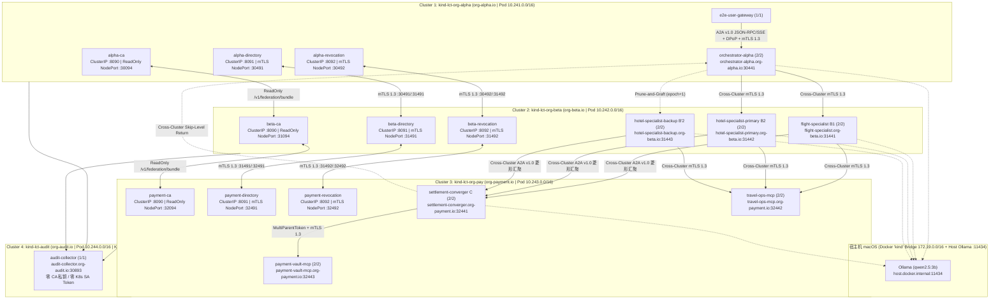

# Lineage Capability Tree (LCT) — Milestone 4 True 4-Cluster Physical Kubernetes Federation + Cross-Cluster mTLS 1.3 + Official A2A v1.0 + Ollama (`qwen2.5:3b`) Guide

本指南说明如何在宿主机上**零网络拉取（Offline Zero-Pull）**拉起 **4 个物理完全独立的 Kind Kubernetes 集群**，并完成 **Milestone 4** 跨集群物理联邦全套 **6 组端到端实测验收（含整集群断网分区 Fail-Closed 与自治重连恢复）**：

1. **真实四集群物理联邦（4 Independent Kind Clusters）**：拥有 4 套物理隔离的 `kube-apiserver`、4 套独立 `etcd`、4 把互不信任的 K8s OIDC RSA 签名密钥（4 distinct `kid`s）、4 组完全不重叠的 Pod/Service CIDR 与 4 套独立集群内 `CoreDNS`（跨集群 `.svc.cluster.local` 100% `NXDOMAIN`，跨集群 Pod IP 直连 100% 三层不可达）；
2. **双端口控制面边界硬化（Dual-Port Control-Plane Boundary Hardening）**：集群内控制面签发/注册/本地吊销端口（`:8090` / `:8091` / `:8092`）严格收敛为集群内 `ClusterIP`；跨集群 NodePort 仅暴露只读公钥束 `:8094`（一切写接口强制 `403 federation_endpoint_read_only`）以及强制双向 X.509 mTLS 1.3 的联邦同步端口 `:8491`（Directory）与 `:8492`（Revocation，外部注册/隔离/吊销写接口一律 `403 federation_port_restricted`）；
3. **公共组织域名寻址 + X.509 `NameConstraints(critical=True)` 强约束**：所有跨集群 `AgentCard`、MCP 端点与联邦控制面统一采用组织公开 FQDN（`*.org-alpha.io`、`*.org-beta.io`、`*.org-payment.io`、`audit-collector.org-audit.io`），叶子 `X.509-SVID` 严格满足各自治根 CA 的 `NameConstraints` 子树约束并在 OpenSSL 握手层双向核验 EKU 与目标信任域固定根 CA；
4. **整集群网络分区韧性（Whole-Cluster Partition Resilience）**：通过 `docker network disconnect kind lct-org-beta-control-plane` 物理切断 `org-beta.io` 整个集群网络时，`org-alpha.io`、`org-payment.io` 与 `org-audit.io` 集群保持 100% 独立存活，同时涉及失联域的 `HIGH_RISK` 分账结算在 3 秒内精准触发 `503 REVOCATION_ANCHOR_UNAVAILABLE` Fail-Closed；网络恢复后零人工重启自动恢复全链路 `200 TASK_STATE_COMPLETED`。

---

## 1. 四集群物理拓扑、网络隔离与端口映射矩阵

- **历史基线零扰动保证**：既有 `kind-agent-identity-lab` 集群中的 `lineage-*` 单集群命名空间已无损清理，`team1`（3/3 Pod `2/2 Running`）等基线命名空间 100% 原封不动，且宿主默认 `kubectl config current-context` 始终保持在 `kind-agent-identity-lab`。

| 物理 Kind 集群 | Kubectl Context | 自治信任域 | Pod CIDR | Service CIDR | 核心工作负载与外部联邦 NodePort 暴露边界 |
| --- | --- | --- | --- | --- | --- |
| **`lct-org-alpha`** | `kind-lct-org-alpha` | `org-alpha.io` | `10.241.0.0/16` | `10.97.0.0/16` | `alpha-ca`（内 `:8090` ClusterIP / 外只读 `:8094->30094`）、`alpha-directory`（内 `:8091` / 外 mTLS `:8491->30491`）、`alpha-revocation`（内 `:8092` / 外 mTLS `:8492->30492`）、`orchestrator-alpha`（`2/2` mTLS `:8443->30441`）、`e2e-user-gateway`（`1/1` `:30990`） |
| **`lct-org-beta`** | `kind-lct-org-beta` | `org-beta.io` | `10.242.0.0/16` | `10.98.0.0/16` | `beta-ca`（外只读 `:31094`）、`beta-directory`（外 mTLS `:31491`）、`beta-revocation`（外 mTLS `:31492`）、`flight-specialist`（`2/2` mTLS `:31441`）、`hotel-specialist-primary`（`2/2` mTLS `:31442`）、`hotel-specialist-backup`（`2/2` mTLS `:31443`） |
| **`lct-org-pay`** | `kind-lct-org-pay` | `org-payment.io` | `10.243.0.0/16` | `10.99.0.0/16` | `payment-ca`（外只读 `:32094`）、`payment-directory`（外 mTLS `:32491`）、`payment-revocation`（外 mTLS `:32492`）、`settlement-converger`（`2/2` mTLS `:32441`）、`travel-ops-mcp`（`2/2` mTLS `:32442`）、`payment-vault-mcp`（`2/2` mTLS `:32443`） |
| **`lct-audit`** | `kind-lct-audit` | `org-audit.io` | `10.244.0.0/16` | `10.100.0.0/16` | `audit-collector`（`1/1` `:8093->30893`，**零 CA 私钥、零 K8s SA Token 挂载**，仅通过三域只读 `:30094/:31094/:32094` 拉取公钥束验签存证） |



---

## 2. 一键构建、四集群拉起实测与无损清理命令

### 2.1 前置检查（确保宿主机 Ollama 正在运行）

```bash
export PATH="/Users/hulalala/Desktop/A/.tools/bin:/Users/hulalala/Desktop/A/.tools/ollama:$HOME/.docker/bin:$PATH"
curl -fsS http://127.0.0.1:11434/v1/models
```

### 2.2 一键离线创建 4 个独立 Kind 集群、注入 CoreDNS 公共组织域名并跑通全部 6 组端到端验收场景

```bash
bash /Users/hulalala/Desktop/A/lineage/k8s/run-e2e-multicluster-ollama.sh
```

> 脚本执行完毕后，4 个 `lct-*` Kind 集群均保持健康运行供独立复核审查，且默认 `kubectl` 上下文自动保持为 `kind-agent-identity-lab`。

### 2.3 一键无损清理 4 个 `lct-*` Kind 集群（100% 保护 `kind-agent-identity-lab` 基线集群）

```bash
bash /Users/hulalala/Desktop/A/lineage/k8s/cleanup-multicluster-k8s.sh
```

---

## 3. Milestone 4 六组跨集群物理联邦实测覆盖矩阵

| 编号 | 场景名称 | 核心跨集群物理隔离与密码学验证目标 |
| --- | --- | --- |
| **Step 5** | 四集群 OIDC JWKS、L3 Pod CIDR、私有 `.svc.cluster.local` DNS 与控制面双端口边界证明 | 验证 4 个集群 `kube-apiserver` 拥有 **4 个不同 OIDC `kid`**（跨集群重放 Alpha SA JWT 至 Beta 内部 CA 返回 `403 Unknown Kubernetes signing kid`）；跨集群解析 `*.svc.cluster.local` 全部 `NXDOMAIN`；跨集群直连对端 Pod IP `:8443` 100% L3 超时；外部 CA `:31094/:32094` 写请求 `403 federation_endpoint_read_only`；外部 Directory `:31491` 注册与外部 Revocation `:31492` 吊销写请求全部 `403` |
| **Scenario 1** | 跨 4 物理集群官方 A2A v1.0 `SendStreamingMessage` (SSE) + `TLSv1.3` + `qwen2.5:3b` Grounding | 经公共组织域名 `https://*.org-*.io:<NodePort>` 完成跨三集群 `TLSv1.3`（`TLS_AES_256_GCM_SHA384`）双向认证、实时推送 `SUBMITTED -> WORKING -> 4x artifactUpdate -> COMPLETED` SSE 流、`Carol` 越权 `GetTask` `403 (-32003)` |
| **Scenario 2 (2A & 2B)** | 跨集群 A2A v1.0 向下 `Atomic Prune-and-Graft`（Cluster Alpha 剪枝 -> Cluster Pay 毫秒级拦截 Cluster Beta 慢僵尸 + `replicas=0` 宕机切换） | `orchestrator-alpha` 在 `alpha-revocation` 剪枝后经 mTLS `:8492` 同步至 `lct-org-pay` 集群 `payment-revocation`；唤醒的 `lct-org-beta` 慢主节点访问 `travel-ops-mcp.org-payment.io:32442` 实测返回 `403 LINEAGE_REVOKED`；替补 `hotel-specialist-backup`（`epoch=1`）无缝接管 |
| **Scenario 3 (3A & 3B)** | 跨集群向上 `Authenticated Skip-Level Return` + 跨集群 mTLS `/healthz` 防欺骗探活 | 3A：Cluster Beta 中间父存活时伪造越级回传被 Cluster Alpha 的跨集群 mTLS `/healthz` 探针拒绝；3B：途中强杀 `kind-lct-org-beta` 中的 `hotel-specialist-primary` Pod 后，`kind-lct-org-pay` 叶子 `settlement-converger` 直接跨集群越级回传 `orchestrator-alpha.org-alpha.io:30441` 获 `200 SKIP_LEVEL_MERGE` |
| **Scenario 4** | 跨三集群 `CancelTask` 级联撤销复制 + Fagin 多父 DAG 平滑降级 + 多租户并发隔离 | `Bob` 调用 `CancelTask` 触发 `lct-org-alpha -> lct-org-beta & lct-org-pay` 跨集群前缀吊销复制（直接进 Cluster Beta 与 Cluster Pay 内部验证撤销树已落盘）；`Alice` 航旅撤销后酒店结算平滑降级 `200 ALLOW_DEGRADED_DAG`、航旅结算 `403 TASK_STATE_FAILED`、`Carol` 并发伦敦行程零误伤 |
| **Scenario 6** | **整集群物理断网分区（`docker network disconnect kind lct-org-beta-control-plane`）+ `503` Fail-Closed + 自治重连恢复** | 物理断开整个 `lct-org-beta` 节点容器网络后：验证 `lct-org-alpha`、`lct-org-pay`、`lct-audit` 共 8 个核心端点全部 `200 OK` 独立存活，而跨失联 `org-beta.io` 谱系的 `HIGH_RISK` 托管分账严格触发 `503 REVOCATION_ANCHOR_UNAVAILABLE` Fail-Closed；执行 `docker network connect` 重连后零重启自动恢复并跑通全新跨三集群差旅结算（`200 TASK_STATE_COMPLETED`） |
| **Scenario 5** | 独立第 4 集群 `kind-lct-audit` 零私钥日志导出与全套 6 场景 `100%` 因果图重构 | 从 `audit-collector.org-audit.io:30893` 导出跨全部 6 组场景的签名哈希链审计流，离线核验前向哈希链完整性与 `100.0%` 因果重构率 |

---

## 4. 最新 Milestone 4 四集群物理联邦实测证据包摘要（`20261120T181931Z-multicluster`）

- **证据目录**：[20261120T181931Z-multicluster](file:///Users/hulalala/Desktop/A/lineage/k8s/runs/20261120T181931Z-multicluster)（历史运行 [20261119T105349Z-multicluster](file:///Users/hulalala/Desktop/A/lineage/k8s/runs/20261119T105349Z-multicluster) 一并完好保留）
- **四集群物理隔离与 OIDC 密钥核验**（[02_multicluster_oidc_and_container_proofs.json](file:///Users/hulalala/Desktop/A/lineage/k8s/runs/20261120T181931Z-multicluster/02_multicluster_oidc_and_container_proofs.json)、[02_multicluster_network_dns_isolation.json](file:///Users/hulalala/Desktop/A/lineage/k8s/runs/20261120T181931Z-multicluster/02_multicluster_network_dns_isolation.json)）：
  - `distinct_kube_apiserver_oidc_kid_count = 4`（4 个独立集群各自独立生成 OIDC 签名密钥，跨集群 SA JWT 重放实测 `403 Unknown Kubernetes signing kid`）；
  - 跨集群 `.svc.cluster.local` 解析 `100% NXDOMAIN`，跨集群直连异域 Pod IP `100%` 三层不可达；
  - 外部联邦端口边界硬化验证全部 `403`；`orchestrator-alpha/app` 为 `ZERO_SA_ZERO_MTLS`，独立第 4 集群 `audit-collector` 为 `KEYLESS_ZERO_SA`；
- **Scenario 6 整集群断网分区与自治恢复核验**（[scenario6_whole_cluster_partition_and_recovery.json](file:///Users/hulalala/Desktop/A/lineage/k8s/runs/20261120T181931Z-multicluster/scenario6_whole_cluster_partition_and_recovery.json)）：
  - `lct-org-beta` 整集群断网期间：其余三集群 8 项健康探针全部 `200`，高危分账在 ~3 秒内精准拒绝并返回 `503 REVOCATION_ANCHOR_UNAVAILABLE`；
  - 网络重连后：自动恢复跨三集群 mTLS 1.3 通信并完成 `task-k8s-s6-recov-20261120T181931Z-multicluster`（`TASK_STATE_COMPLETED`，机票 `$580.0` + 酒店 `$360.0` 双分支 `ALLOW`）；
- **全集群第三方无私钥因果审计结果**（[scenario5_causal_audit_report.json](file:///Users/hulalala/Desktop/A/lineage/k8s/runs/20261120T181931Z-multicluster/scenario5_causal_audit_report.json)）：
  - 导出签名哈希链日志总条数：**283 条**（覆盖 **10 条**跨集群独立工作负载审计流）；
  - 前向哈希链完整性：`stream_hash_chain_integrity_ok = true`；
  - 授权链因果重建率：**`15 / 15`（`100.0%`）**，`clean = true`（`anomalies = []`），自动核验通过 `VERIFIED_FAILOVER_GRAFT` 与 `VERIFIED_SKIP_LEVEL_MERGE`；
  - 敏感凭据扫描：全目录 **0 私钥、0 明文 JWS/SVID、0 明文 `lct1.` / `lctmp1.` / `lctm1.` 令牌**；基线集群 `kind-agent-identity-lab`（`team1`）前后快照完全一致（3/3 Pod `2/2 Running`）。
